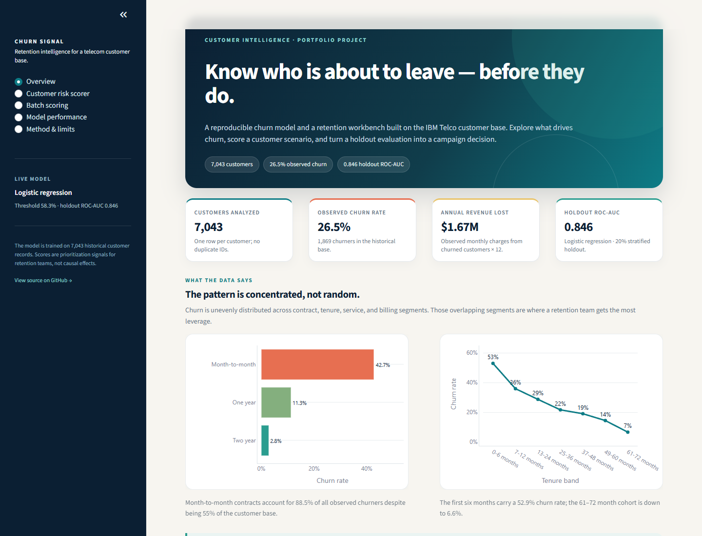
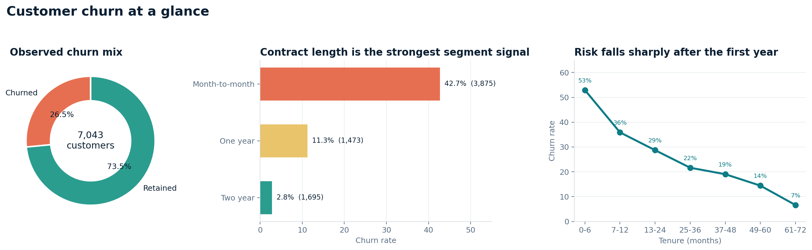
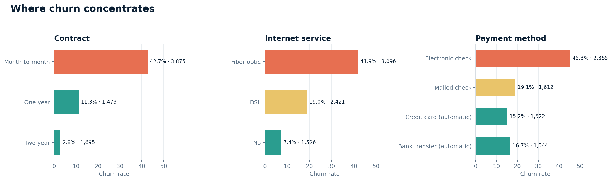
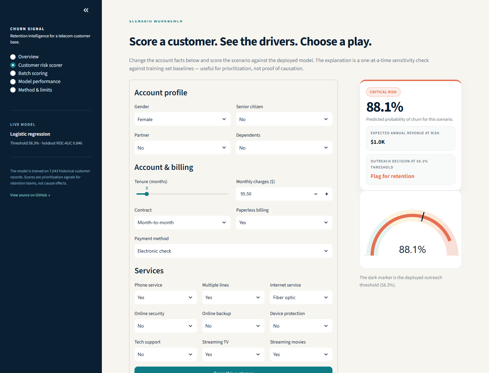
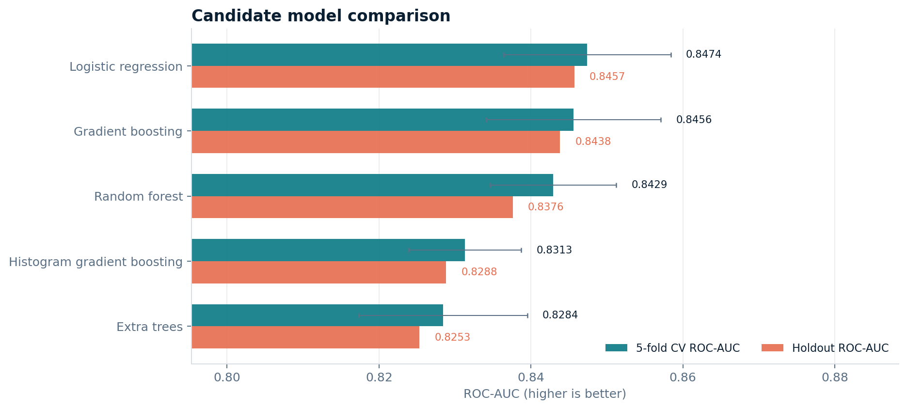

# Churn Signal — Customer Churn Prediction

[](https://github.com/mlaharsh/Customer_Churn_Prediction/actions/workflows/ci.yml)
[](https://mlaharsh.github.io/Customer_Churn_Prediction/)
[](https://mlaharsh.github.io/Customer_Churn_Prediction/scorer.html)
[](https://www.python.org/)
[](docs/deployment.md)
[](LICENSE)

An end-to-end customer churn portfolio project built on the public IBM Telco Customer Churn dataset. It combines a reproducible scikit-learn pipeline, a downloadable model bundle, a public client-side scorer, a multi-page Streamlit retention workbench, generated evaluation reports, tests, CI, Docker, and a static GitHub Pages showcase.

The goal is not just to predict who leaves. It is to make the trade-off between **catching churners** and **wasting outreach capacity** explicit, then translate model output into a retention decision a team can actually run.

- **Live showcase:** https://mlaharsh.github.io/Customer_Churn_Prediction/
- **Live scorer:** https://mlaharsh.github.io/Customer_Churn_Prediction/scorer.html — the exported model running client-side; no login or server
- **Native Streamlit app:** run locally with `streamlit run app.py` (deployment guide in [`docs/deployment.md`](docs/deployment.md))
- **Evaluation report:** [`reports/evaluation/summary.md`](reports/evaluation/summary.md) · **Model card:** [`docs/model_card.md`](docs/model_card.md)



## Results at a glance

| Metric | Result |
| --- | --- |
| Dataset | 7,043 customers · 21 raw columns · 26.54% observed churn |
| Selected model | Logistic regression |
| Selection rule | Best 5-fold stratified CV ROC-AUC |
| CV ROC-AUC | **0.8474** ± 0.0110 |
| Holdout ROC-AUC | **0.8457** |
| Outreach threshold | **0.583**, tuned on out-of-fold predictions |
| Holdout precision | **54.9%** |
| Holdout recall | **72.2%** |
| Holdout F1 | **0.624** |
| Top-decile churn capture | **28.6%** of churners · **2.86×** lift |
| Observed annualised churn revenue | **$1.67M** |

The model flags 492 of 1,409 holdout customers at the selected threshold (34.9%). It catches 270 of 374 churners while contacting 222 retained customers — a deliberate trade-off chosen for a retention campaign, not for raw accuracy.

## Why this is a useful ML project

- **One deterministic pipeline** from raw CSV to a serialized model, metrics, test predictions, and figures.
- **Leakage-aware evaluation**: preprocessing lives inside the model pipeline, the threshold is tuned on out-of-fold training predictions, and the holdout set is touched once.
- **A real decision surface**: the app lets a user move the threshold and see precision, recall, contact volume, and campaign economics change.
- **A deployable product**: Streamlit workbench, CSV batch scoring, a static Pages showcase, Docker, and GitHub Actions.
- **A clear model card**: intended use, evaluation, and limitations are documented rather than hidden behind a single accuracy number.

## What the data says

Churn is concentrated. Month-to-month contracts churn at **42.7%** versus **11.3%** on one-year and **2.8%** on two-year contracts. The first six months are the highest-risk lifecycle stage at **52.9%**, and fiber-optic customers churn at **41.9%**.

These segments overlap, which is why a focused campaign can reach a large share of the exposure:

- Month-to-month customers are **55.0%** of the base but **88.5%** of observed churners.
- Fiber-optic customers are **44.0%** of the base but **69.4%** of churners.
- Electronic-check customers are **33.6%** of the base but **57.3%** of churners.
- The overlap is the sharpest target: month-to-month fiber accounts are **30.2%** of the base, churn at **54.6%**, and represent **62.2%** of churners and **72.2%** of annualised observed churn revenue.





The recommended retention plays are therefore specific: annual-contract incentives for the right month-to-month accounts, a structured first-90-days onboarding motion, and a fiber service-quality / price-to-value review. These are prioritisation hypotheses tied to observable account facts, not proven causal interventions.

## The product

Churn Signal ships in two forms: a five-page **Streamlit workbench** and a public **client-side scorer**.

| Page | What it does |
| --- | --- |
| **Overview** | Business KPIs, churn concentration, segment scorecard, and retention plays. |
| **Customer risk scorer** | Scores a single account, shows risk band, revenue exposure, one-at-a-time drivers, and suggested actions. |
| **Batch scoring** | Uploads a CSV, validates the schema, scores every customer, and exports the result. |
| **Model performance** | Replays the holdout evaluation, compares candidates, and lets you test a different outreach threshold. |
| **Method & limits** | Model card, data dictionary, reproduction steps, and responsible-use notes. |

The **live scorer** at https://mlaharsh.github.io/Customer_Churn_Prediction/scorer.html exposes single-account scoring, the holdout threshold lab, and CSV batch scoring in the browser. It runs the exported logistic-regression coefficients and preprocessing parameters from `models/churn_model.joblib`; there is no server, login, or upload. It is a static implementation of the same model, not a Streamlit Cloud deployment. The Streamlit workbench above remains the full native reference.

The scorer is interactive: change tenure, contract, services, or billing facts and see the probability and retention recommendation update. The explanation is a transparent sensitivity check against training-set baselines — useful for prioritisation, not proof of causation.



## How the pipeline works

```text
data/raw/telco_churn.csv
        │
        ▼
schema validation + explicit TotalCharges handling
        │
        ▼
feature engineering
  AvgMonthlySpend · ServiceCount · IsNewCustomer
        │
        ▼
5 candidate pipelines × 5-fold stratified CV
  logistic regression · random forest · gradient boosting
  histogram gradient boosting · extra trees
        │
        ▼
select by CV ROC-AUC
        │
        ▼
tune F1 threshold on out-of-fold training predictions
        │
        ▼
one holdout evaluation (ROC-AUC, PR-AUC, Brier, confusion matrix)
        │
        ▼
refit the winning pipeline on all labelled rows
        │
        ▼
models/churn_model.joblib + models/metrics.json
reports/evaluation/*.csv + reports/figures/*.png
```

The cleaning step is intentionally explicit. The source file has **11 blank `TotalCharges` values**, all for customers with `tenure=0`; those are filled from `MonthlyCharges × tenure`, which is zero. `SeniorCitizen` is normalised from `0/1` to `No/Yes`. The original 21-column schema is preserved for batch scoring, while the model uses 22 engineered features (categorical values are one-hot encoded inside the pipeline).

## Model comparison

| Candidate | CV ROC-AUC | Holdout ROC-AUC | Holdout F1 @ 0.5 |
| --- | ---: | ---: | ---: |
| **Logistic regression** | **0.8474** | **0.8457** | 0.6175 |
| Gradient boosting | 0.8456 | 0.8438 | 0.5904 |
| Random forest | 0.8429 | 0.8376 | 0.6135 |
| Histogram gradient boosting | 0.8313 | 0.8288 | 0.5690 |
| Extra trees | 0.8284 | 0.8253 | 0.5868 |

Logistic regression wins by CV ROC-AUC and is also the simplest model to explain, serialize, and monitor. Gradient boosting is close but does not improve the ranking metric on this dataset. The full comparison and figures are regenerated by `python -m churn.train`.



### Decision policy

The default threshold is **0.583**, selected to maximise F1 on out-of-fold training predictions. On the untouched holdout set:

| | Predicted retain | Predicted churn |
| --- | ---: | ---: |
| **Actually retained** | 813 | 222 |
| **Actually churned** | 104 | 270 |

A lower threshold contacts more customers and catches more churners; a higher threshold protects outreach capacity. The **Model performance** page exposes this slider so the policy can be discussed explicitly rather than buried in a notebook.

## Quickstart

### Local environment

```bash
git clone https://github.com/mlaharsh/Customer_Churn_Prediction.git
cd Customer_Churn_Prediction
python -m venv .venv
```

Windows:

```powershell
.venv\Scripts\activate
python -m pip install -r requirements-dev.txt
python -m churn.train
streamlit run app.py
```

macOS / Linux:

```bash
source .venv/bin/activate
python -m pip install -r requirements-dev.txt
python -m churn.train
streamlit run app.py
```

Open `http://localhost:8501`. Training takes about a minute on a laptop and rewrites `models/` and `reports/`. The committed artifacts are sufficient to run the app without retraining.

### Tests

```bash
python -m pytest -q
python -m churn.browser_export --check
node tests/browser_scorer.test.js
```

The Python suite covers the data contract, cleaning edge cases, preprocessing, risk bands, scoring, explanations, model serialization, the committed evaluation artifacts, headless rendering of all five app pages, and the browser-export contract. The Node suite checks that the JavaScript scorer reproduces the Python probabilities and the saved holdout threshold counts.

### Docker

```bash
docker build -t churn-signal .
docker run --rm -p 8501:8501 churn-signal
```

Open `http://localhost:8501`.

## Batch scoring

Use the **Batch scoring** page to upload a CSV. The template is available in the app and in `data/raw/telco_churn.csv` (drop the `Churn` column).

Required columns are the 19 raw feature columns plus an optional `customerID`:

```text
customerID, gender, SeniorCitizen, Partner, Dependents, tenure, PhoneService,
MultipleLines, InternetService, OnlineSecurity, OnlineBackup, DeviceProtection,
TechSupport, StreamingTV, StreamingMovies, Contract, PaperlessBilling,
PaymentMethod, MonthlyCharges, TotalCharges
```

- Missing customer IDs are generated as `row-1`, `row-2`, and so on.
- `Churn` is optional and ignored if present.
- Blank `TotalCharges` is filled as `MonthlyCharges × tenure`; for a new customer with `tenure=0`, that is zero.
- Duplicate customer IDs are rejected.
- A maximum of 50,000 rows is accepted in the interactive app.

The download contains the probability, risk tier, outreach flag, expected annual revenue at risk, and the original account facts needed to work the list.

## Repository layout

```text
.
├── app.py                         # Streamlit workbench
├── churn/
│   ├── config.py                  # paths, feature lists, risk bands, palette
│   ├── data.py                    # schema validation, cleaning, inference prep
│   ├── features.py                # shared scikit-learn preprocessor
│   ├── insights.py                # scoring, risk tiers, what-if explanations
│   ├── modeling.py                # candidates, CV, threshold tuning, serialization
│   ├── reporting.py               # evaluation figures and tables
│   ├── browser_export.py          # exports fitted parameters for the static scorer
│   └── train.py                   # reproducible CLI entry point
├── data/raw/telco_churn.csv       # canonical public dataset
├── models/
│   ├── churn_model.joblib         # deployable bundle
│   ├── metrics.json               # generated metrics and segment tables
│   └── feature_importance.csv
├── reports/
│   ├── evaluation/                # summary, predictions, deciles, comparison
│   └── figures/                   # generated PNGs used in docs/README
├── notebooks/legacy_churn_analysis.ipynb
├── tests/
│   └── browser_scorer.test.js     # Node parity checks for the public scorer
├── docs/
│   ├── index.html                 # static GitHub Pages showcase
│   ├── scorer.html                # live client-side scorer
│   ├── scorer.js                  # scoring, threshold, and CSV logic
│   ├── scorer_ui.js               # form, result, and batch UI glue
│   ├── scorer_data.js             # generated model/preprocessing/holdout payload
│   ├── assets/                    # screenshots and copied figures
│   ├── model_card.md
│   ├── data_dictionary.md
│   └── deployment.md
├── .github/workflows/
│   ├── ci.yml                     # tests, browser parity, rebuild, Streamlit smoke test
│   └── pages.yml                  # GitHub Pages deployment
├── Dockerfile
├── requirements.txt
├── requirements-dev.txt
└── pyproject.toml
```

The original notebook is preserved at `notebooks/legacy_churn_analysis.ipynb` as historical context. It is not part of the production path; the reproducible pipeline in `churn/` is the source of truth.

## Deployment

### GitHub Pages

The static showcase and live scorer are deployed from `docs/` by `.github/workflows/pages.yml`. On a push to `master` that changes `docs/`, GitHub Actions uploads the folder as a Pages artifact and deploys it.

- Showcase: **https://mlaharsh.github.io/Customer_Churn_Prediction/**
- Live scorer: **https://mlaharsh.github.io/Customer_Churn_Prediction/scorer.html**

The scorer is a real client-side implementation of the fitted model, not a screenshot and not a Streamlit deployment. `python -m churn.browser_export` writes the exact coefficients and preprocessing parameters from `models/churn_model.joblib` to `docs/scorer_data.js`; the threshold lab replays the saved holdout predictions. CI fails if that generated file is stale or if the JavaScript probabilities drift from Python. See [`docs/deployment.md`](docs/deployment.md#browser-scorer-live) for details.

### Streamlit Community Cloud

The app is designed for a zero-secret Streamlit Community Cloud deployment:

1. Push the repository to GitHub.
2. Sign in to [share.streamlit.io](https://share.streamlit.io) with GitHub.
3. Create a new app from `mlaharsh/Customer_Churn_Prediction`, branch `master`, main file `app.py`.
4. Select Python 3.11 and deploy.

No environment variables are required; the app reads the committed model and evaluation artifacts. Step-by-step instructions, including Docker and local alternatives, are in [`docs/deployment.md`](docs/deployment.md). The Streamlit app is not claimed as publicly deployed in this README unless a live URL is added; the public interactive surface is the GitHub Pages scorer above.

### CI

`.github/workflows/ci.yml` runs:

- the pytest suite on Python 3.11 and 3.12;
- a browser-scorer job that checks `docs/scorer_data.js` freshness, validates JavaScript syntax, and runs the Node/Python parity tests;
- a two-fold training run that verifies the artifact export path;
- a Streamlit health-check smoke test.

The Pages workflow is separate, so documentation changes do not block model CI.

## Method notes

**No leakage.** The scalar, one-hot encoder, and model are one `Pipeline`. Cross-validation refits preprocessing inside each fold. The threshold is tuned on out-of-fold predictions from the training split. The holdout set is used once for the final evaluation, then the selected pipeline is refit on all labelled rows for deployment.

**Reproducibility.** `RANDOM_STATE = 42`, a stratified 80/20 split, fixed candidate hyperparameters, and a deterministic cleaning policy. Generated artifacts are committed so the app can run immediately; retraining rewrites them.

**Why the threshold matters.** A churn model produces a ranking, not a campaign. The threshold converts ranking into contact volume. The app exposes the precision/recall/contact-volume trade-off and the resulting expected revenue exposure, so the operating point can be chosen against a real retention capacity constraint.

**Metrics are retrospective.** The holdout is a single historical split, not a temporal validation. The historical Telco dataset may not represent a current customer population, and the model does not estimate uplift from a retention offer.

## Limitations and responsible use

- **Retrospective evaluation only.** No temporal holdout or live A/B test has been run. A production deployment should validate on a time-based split and track drift.
- **Correlation, not causation.** The what-if explanations reset one feature to a baseline; they do not answer “what happens if we change this customer’s contract?”
- **No uplift model.** The model predicts churn risk, not the probability that an offer will save the customer. Pair it with a holdout or matched control group before claiming saved revenue.
- **Fairness review is required.** Gender and senior-citizen status are present in the source schema. They are not used to make credit, pricing, or eligibility decisions here, but any production use should audit subgroup performance and business impact.
- **Calibration is imperfect.** The Brier score is 0.1657; probabilities are useful for ranking and campaign sizing but should not be read as exact individual odds.
- **Dataset provenance.** This is a public, anonymised IBM/Kaggle Telco dataset. See the source link below and [`docs/data_dictionary.md`](docs/data_dictionary.md).

## License

MIT. See [`LICENSE`](LICENSE).

## Acknowledgements

- Dataset: [IBM Telco Customer Churn on Kaggle](https://www.kaggle.com/datasets/blastchar/telco-customer-churn).
- The original exploratory notebook is preserved for context; the production implementation, tests, app, and documentation are this repository's reproducible rebuild.
- Built with scikit-learn, pandas, Streamlit, Plotly, pytest, and GitHub Actions.
