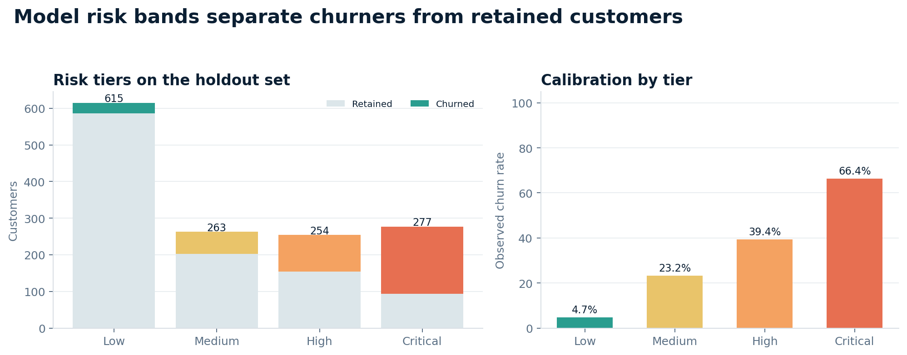

# Evaluation summary

Generated by `python -m churn.train`. This file is the source of truth for the headline numbers in the README.

## Dataset

- Rows: **7,043** customers
- Observed churn rate: **26.54%** (1,869 churners)
- Monthly recurring revenue represented: **$456,117**
- Monthly revenue lost to observed churn: **$139,131**

## Model selection

- Selected: **Logistic regression**
- 5-fold CV ROC-AUC: **0.8474** (± 0.0110)
- Holdout ROC-AUC: **0.8457**
- Decision threshold tuned on out-of-fold predictions: **0.583**

| Candidate | CV ROC-AUC | Holdout ROC-AUC | Holdout F1 @ 0.5 |
| --- | ---: | ---: | ---: |
| Logistic regression **(selected)** | 0.8474 | 0.8457 | 0.6175 |
| Gradient boosting | 0.8456 | 0.8438 | 0.5904 |
| Random forest | 0.8429 | 0.8376 | 0.6135 |
| Histogram gradient boosting | 0.8313 | 0.8288 | 0.5690 |
| Extra trees | 0.8284 | 0.8253 | 0.5868 |

## Holdout performance at the selected threshold

| Metric | Value |
| --- | ---: |
| Accuracy | 0.7686 |
| Precision | 0.5488 |
| Recall | 0.7219 |
| F1 | 0.6236 |
| ROC-AUC | 0.8457 |
| PR-AUC | 0.6532 |
| Brier score | 0.1657 |
| Top-decile churn capture | 28.61% |
| Top-decile lift | 2.86x |

## Strongest permutation-importance features

| Feature | Mean ROC-AUC drop | Share |
| --- | ---: | ---: |
| tenure | 0.0485 | 21.2% |
| InternetService | 0.0446 | 19.5% |
| Contract | 0.0432 | 18.9% |
| MonthlyCharges | 0.0420 | 18.4% |
| IsNewCustomer | 0.0192 | 8.4% |
| ServiceCount | 0.0060 | 2.6% |
| OnlineSecurity | 0.0046 | 2.0% |
| TechSupport | 0.0042 | 1.8% |

## Figures

See `reports/figures/` for ROC, precision–recall, calibration, threshold, and feature-importance charts.
